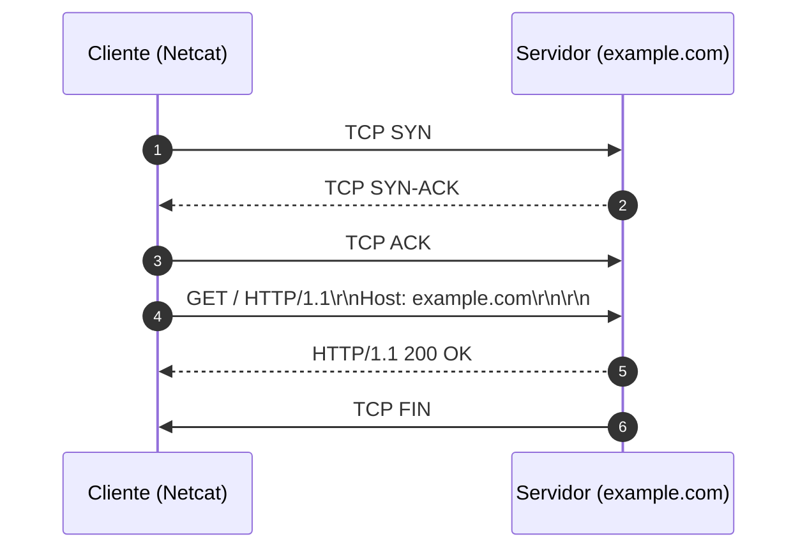

# Memória de Desenvolvimento — Semana 01
**Aluno:** Kayki Santana Guimarães
**Matrícula:** 202421200080  
**Curso:** Sistemas de Informação  

---

## 1. Mapeamento da Camada de Transporte
Diagrama Mermaid:

### Análise do Diagrama
1. **Passos 1 a 3, handshake de três vias:** o cliente envia `SYN`, o servidor responde `SYN-ACK` e o cliente confirma com `ACK`. Só depois disso a conexão TCP está estabelecida e os dois lados podem trocar dados. 
2. **Passo 4, requisição HTTP:** o cliente envia a request `GET / HTTP/1.1` e o header `Host: example.com`, cada linha terminada em `\r\n`. A linha em branco final, `\r\n\r\n`, indica ao servidor que os headers acabaram. O `Host` é obrigatório no HTTP/1.1 porque um mesmo IP pode hospedar vários sites.
3. **Passo 5, resposta HTTP:** o servidor responde com o status`HTTP/1.1 200 OK`, seguida dos headers e do HTML. 
4. **Passo 6, encerramento:** como a resposta trouxe `Connection: close`, o servidor envia `FIN` logo após o último byte do corpo e a conexão se encerra. 

É importante notar que o HTTP só incia após a estabilização da conexão TCP e se encerra antes da finalização dela. 

---

## 2. Captura e Análise do Protocolo
* **Comando Utilizado:** `nc -C example.com 80`
* **Status Line Retornada:** `HTTP/1.1 200 OK`

### Análise dos Headers Recebidos:
1. **`Content-Type`:** O servidor retornou `text/html; charset=UTF-8`. Esse header diz ao cliente que o corpo é um documento HTML codificado em UTF-8. O parser usa essa informação para decidir como interpretar os bytes: como HTML para renderizar, e não como JSON, imagem ou qualquer outro formato. Se não houvesse ele, o cliente teria que saber o formato pelo conteúdo. 
2. **`Content-Length`:** O servidor retornou `Content-Length: 1256`, ou seja, o corpo tem 1256 bytes. O TCP entrega só um fluxo contínuo de bytes, sem marcar onde uma mensagem termina. Por isso o cliente lê os headers até a linha em branco e depois conta exatamente 1256 bytes de corpo. Se chegarem menos bytes, ele sabe que a resposta foi truncada.
3. **`Connection: close`:** O servidor avisou que vai fechar o socket assim que terminar de enviar a resposta, e por isso aparece o `FIN` no diagrama. Fechar logo significa que cada requisição precisa de um novo handshake de três vias. No keep-alive, o socket continua aberto e é reaproveitado para várias requisições, o que economiza handshakes e reduz a latência, mas exige que cada resposta seja delimitada. 

---

## 3. Conclusão Técnica
O HTTP não é um arquivo estático. São mensagens em texto ASCII, enviadas como bytes sobre TCP, em que cada linha termina em CRLF e uma linha em branco separa os headers do corpo. Ao digitar a requisição manualmente no Netcat com a opção `-C`, que converte as quebras de linha em CRLF, fica claro que a requisição é só uma sequência de bytes no formato da especificação. Se o formato falhar, por exemplo sem o header `Host`, que é obrigatório no HTTP/1.1, o servidor rejeita a requisição. O TCP não delimita mensagens, então o próprio HTTP tem que fazer isso. 
