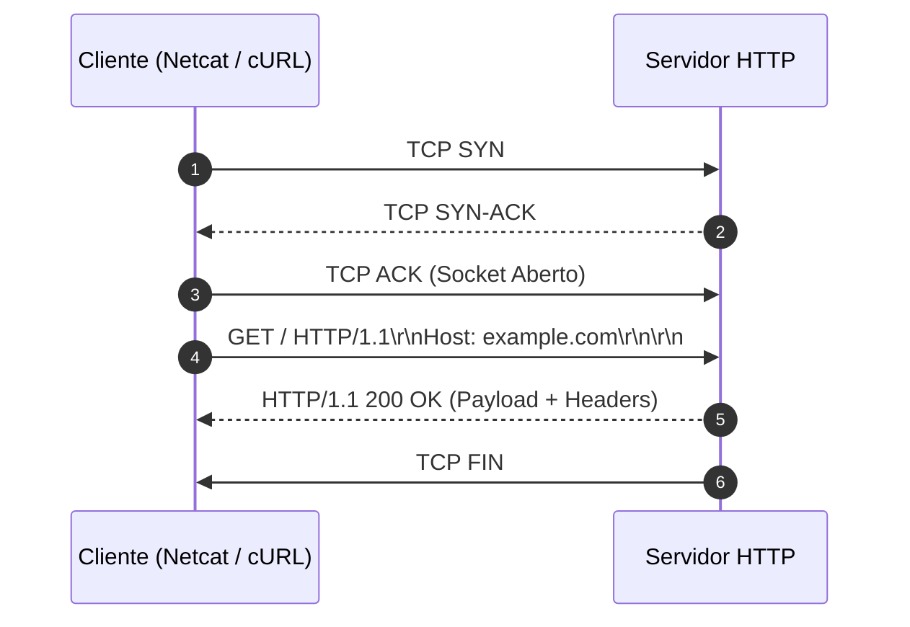

# Memória de Desenvolvimento — Semana 01: Protocolo HTTP & Sockets Bare-Metal
**Aluno:** Kayki Santana Guimarães
**Matrícula:** 202421200080 
**Curso:** Sistemas de Informação  

---

## 1. Mapeamento da Camada de Transporte
Diagrama Mermaid:



### Análise do Diagrama
1. **Passos 1 a 3, handshake de três vias:** o cliente envia `SYN`, o servidor responde `SYN-ACK` e o cliente confirma com `ACK`. Só depois disso o socket está aberto e os dois lados podem trocar dados.
2. **Passo 4, requisição HTTP:** o cliente envia a request `GET / HTTP/1.1` e o header `Host: example.com`, cada linha terminada em `\r\n`. A linha em branco final, `\r\n\r\n`, avisa ao servidor que os headers acabaram.
3. **Passo 5, resposta HTTP:** o servidor responde com status `HTTP/1.1 200 OK`, os headers e o corpo.
4. **Passo 6, encerramento:** o servidor envia `FIN` depois do último byte do corpo e a conexão é fechada.

---

## 2. Registro dos Experimentos de Laboratório

### Experimento 1: Netcat & Falha 400 Bad Request
* **Comando Testado:** `nc -C example.com 80` sem o header `Host:`
```
$ nc -C example.com 80
GET / HTTP/1.1

HTTP/1.1 400 Bad Request
Connection: close
```
* **Resultado:** O servidor retornou `HTTP/1.1 400 Bad Request`. No HTTP/1.1 o header `Host` é obrigatório porque um mesmo IP pode hospedar vários sites, o chamado Virtual Hosting, e só o `Host` diz ao servidor qual site entregar.

### Experimento 2: Semântica dos Métodos HTTP
* **Análise dos Verbos:** O `GET` pede um recurso disponível no servidor. O `POST` envia dados no corpo para o servidor processar, como criar um registro. O `OPTIONS` pergunta ao servidor quais métodos ele aceita para aquele recurso.
* **Header Content-Length:** O servidor interpreta os cabeçalhos até encontrar uma linha em branco. O Content-Length informa quantos bytes compõem o corpo da requisição. Se o cliente enviar menos bytes do que declarou, o servidor pode aguardar o restante até ocorrer um timeout ou outro erro.

### Experimento 3: URL, Query Strings & Percent-Encoding
* **URL Testada: (Passo 1)** curl -v http://httpbin.org/get?curso=Engenharia da Computacao
* **URL Testada: (Passo 2)** curl -v https://httpbin.org/get?curso=Engenharia%20da%20Computa%C3%A7%C3%A3o
* **O erro no Passo 1:** Ao fornecer a URL com espaços sem codificação e sem aspas ao redor do endereço, o shell separou a entrada em argumentos. Assim, o cURL tentou interpretar da e Computacao como hosts adicionais, resultando no erro Could not resolve host. A resposta do primeiro pedido mostra que o parâmetro curso chegou ao servidor apenas com o valor Engenharia.
* **A função do `%20`:** A `%` indica que os próximos dígitos representarão um valor hexadecimal de 1 byte. Na tabela ASCII a representação do `espaço` é o `20`, com isso o servidor consegue decodificar e entender o byte como o valor desejado, nesse caso, o espaço.

```
{
  "args": {
    "curso": "Engenharia"
  },
  "headers": {
    "Accept": "*/*",
    "Host": "httpbin.org",
    "User-Agent": "curl/8.18.0",
    "X-Amzn-Trace-Id": "Root=1-6add2a3f-362763b8007c206834a4e66e"
  },
  "origin": "138.59.122.215",
  "url": "http://httpbin.org/get?curso=Engenharia"
}
* Connection #0 to host httpbin.org:80 left intact
* Could not resolve host: da
* Store negative name resolve for da:80
* shutting down connection #1
curl: (6) Could not resolve host: da
* Could not resolve host: Computacao
* Store negative name resolve for Computacao:80
* shutting down connection #2
curl: (6) Could not resolve host: Computacao

```
```
{
  "args": {
    "curso": "Engenharia da Computa\u00e7\u00e3o"
  },
  "headers": {
    "Accept": "*/*",
    "Host": "httpbin.org",
    "User-Agent": "curl/8.18.0",
    "X-Amzn-Trace-Id": "Root=1-6add3217-7dd4bd6e3ceb79b450630fe3"
  },
  "origin": "138.59.122.215",
  "url": "https://httpbin.org/get?curso=Engenharia da Computa\u00e7\u00e3o"
}
```

### Experimento 4: Negociação de Conteúdo & User-Agent
* **Análise:** O servidor recebe os cabeçalhos enviados pelo cliente e pode utilizá-los para decidir como responder. O cabeçalho `Accept` informa quais formatos de conteúdo o cliente aceita. No teste, ao enviar `Accept: application/json`, o httpbin retornou esse valor no JSON, confirmando que recebeu o cabeçalho. Sem essa personalização, o cURL enviou `Accept: */*`, indicando que aceita qualquer tipo de mídia. Já o cabeçalho `User-Agent` identifica o cliente por meio de uma string que pode informar o navegador e o sistema operacional. Ao enviar um `User-Agent` simulando um dispositivo Android, o httpbin retornou exatamente o valor informado.

### Experimento 5: Redirecionamentos & Cache Condicional
```
$ curl -I http://google.com
HTTP/1.1 301 Moved Permanently
Location: http://www.google.com/

$ curl -I -L http://google.com
HTTP/1.1 301 Moved Permanently
Location: http://www.google.com/

HTTP/1.1 200 OK
```
* **Redirecionamento (301):** Sem `-L`, o `curl -I` mostra só o `301` com o header `Location` e para. Com `-L`, ele segue o `Location` e mostra também a resposta final.
```
$ curl -i https://httpbin.org/etag/abc123
HTTP/1.1 200 OK
ETag: "abc123"

$ curl -i -H 'If-None-Match: "abc123"' https://httpbin.org/etag/abc123
HTTP/1.1 304 Not Modified
```
* **Validação de Cache (304):** O servidor envia um `ETag` que identifica a versão do recurso. O cliente devolve esse valor no `If-None-Match` e, se nada mudou, o servidor responde só `304 Not Modified`, sem o corpo.

---

## 3. Conclusão Técnica
O HTTP define a estrutura das mensagens trocadas entre clientes e servidores. No HTTP/1.1, a linha de status, a linha de requisição e os cabeçalhos seguem uma sintaxe textual baseada em octetos, com linhas separadas por CRLF. Uma linha em branco marca o fim dos cabeçalhos, enquanto mecanismos como `Content-Length` e `Transfer-Encoding: chunked` delimitam o corpo da mensagem.

Entender esses mecanismos é importante para desenvolver sistemas confiáveis. A reutilização de conexões, o uso adequado de cache e o tratamento correto de redirecionamentos podem reduzir transferências desnecessárias e melhorar o desempenho. Os experimentos também mostram como cabeçalhos e codificação de URLs influenciam a comunicação entre cliente e servidor.
