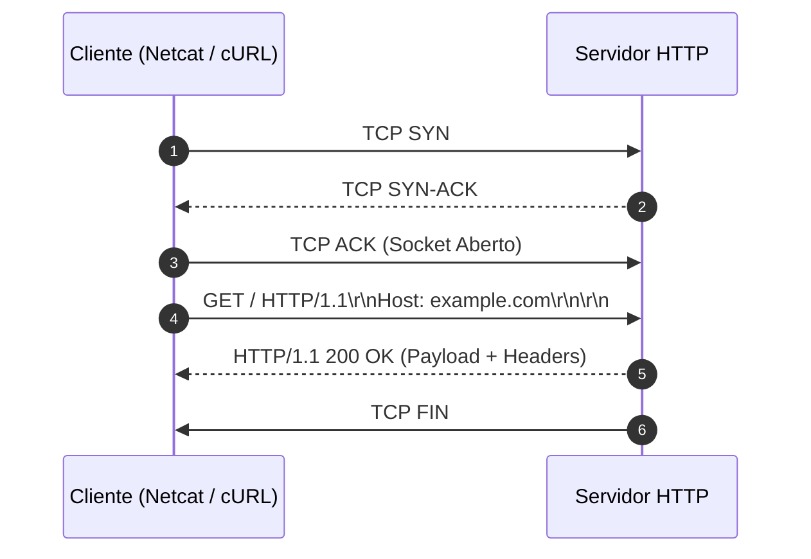

# Memória de Desenvolvimento — Semana 01: Protocolo HTTP & Sockets Bare-Metal
**Aluno:** Kayki Santana Guimarães  
**Matrícula:** 202421200080  
**Curso:** Sistemas de Informação  

---

## 1. Mapeamento da Camada de Transporte
Diagrama Mermaid demonstrando o ciclo de vida da requisição executada no laboratório:

O diagrama representa o estabelecimento de uma conexão TCP, a transmissão da requisição HTTP e o encerramento da conexão. Primeiro, o cliente envia um pacote SYN, o servidor responde com SYN-ACK e o cliente confirma com ACK, completando o three-way handshake. Após isso, a requisição HTTP é transmitida por um socket.

Após processar a requisição, o servidor envia uma resposta HTTP contendo cabeçalhos e um payload quando aplicável. Por fim, a conexão TCP pode ser encerrada por meio de um pacote FIN.

---

## 2. Registro dos Experimentos de Laboratório

### Experimento 1: Netcat Nu & Falha 400 Bad Request
* **Comando Testado:** `nc -C example.com 80` sem o header `Host:`
* **Resultado:** o servidor retorna `400 Bad Request`, porque uma requisição HTTP/1.1 sem o cabeçalho `Host` é considerada inválida. O Virtual Hosting necessita desse cabeçalho, pois o servidor deve saber qual site o cliente deseja acessar.

### Experimento 2: Semântica dos Métodos HTTP
* **Análise dos Verbos:**
  * `GET`: utilizado para solicitar a representação de um recurso/dado.
  * `POST`: utilizado para enviar dados ao servidor, geralmente para processamento, criação de recursos ou envio de formulário.
  * `OPTIONS`: utilizado para consultar quais métodos ou opções de comunicação são suportados por um servidor ou recurso.
* **Header Content-Length:** o cabeçalho `Content-Length` informa o tamanho do corpo da requisição em bytes. Como os sockets TCP oferecem um fluxo contínuo de bytes, não há garantia de que todo o corpo chegará em uma única operação de leitura. O servidor precisa controlar quantos bytes já foram recebidos e continuar lendo até completar o tamanho esperado. Se o tamanho fornecido estiver incorreto, poderão ocorrer leituras incompletas.

### Experimento 3: URL, Query Strings & Percent-Encoding
* **URL Testada: (Passo 1)** curl -v http://httpbin.org/get?curso=Engenharia da Computacao
* **URL Testada: (Passo 2)** curl -v https://httpbin.org/get?curso=Engenharia%20da%20Computa%C3%A7%C3%A3o
* **O erro no Passo 1:** [Descreva o que o terminal retornou]
* **A função do `%20`:**

| Representação | Código hexadecimal | Significado |
|---|---|---|
| `%20` | 0x20 | Espaço |
| `%C3%A7` | C3 A7 | Caractere "ç" |

### Experimento 4: Negociação de Conteúdo & User-Agent
* **Análise:** o cabeçalho `Accept` informa quais tipos de conteúdo o cliente prefere receber. Por exemplo, `Accept: application/json` indica preferência por respostas JSON, enquanto `Accept: text/html` indica preferência por HTML. O cabeçalho `User-Agent` identifica o software cliente, podendo informar navegador, ferramenta ou versão.

### Experimento 5: Redirecionamentos & Cache Condicional
* **Redirecionamento (301):** o código `301 Moved Permanently` indica que o recurso foi movido permanentemente para outra URL. O comando `curl -I` exibe os cabeçalhos da resposta inicial, enquanto `curl -I -L` segue os redirecionamentos e exibe também os cabeçalhos das respostas seguintes.
* **Validação de Cache (304):** o cabeçalho `ETag` identifica uma versão de um recurso. O cliente pode enviar o cabeçalho `If-None-Match` com esse identificador para verificar se o recurso foi alterado. Se não houver alterações, o servidor retorna `304 Not Modified`. Se o recurso for modificado, o servidor envia a nova versão.

---

## 3. Conclusão Técnica
Compreender a transmissão de bytes e a sintaxe dos protocolos de aplicação é fundamental para desenvolver sistemas distribuídos confiáveis e eficientes. No HTTP, os cabeçalhos, os métodos, os códigos de status e o corpo da mensagem seguem uma estrutura padrão. A separação entre os campos de cabeçalho e o corpo utiliza a sequência CRLF para encerrar linhas e uma linha vazia para indicar o fim dos cabeçalhos. Uma interpretação errada desses delimitadores pode causar erros de leitura.

Além disso, o estudo dos sockets TCP mostra que os dados são transmitidos como um fluxo de bytes, sem preservar necessariamente os limites das mensagens HTTP. Por isso, precisamos implementar mecanismos adequados de leitura.
