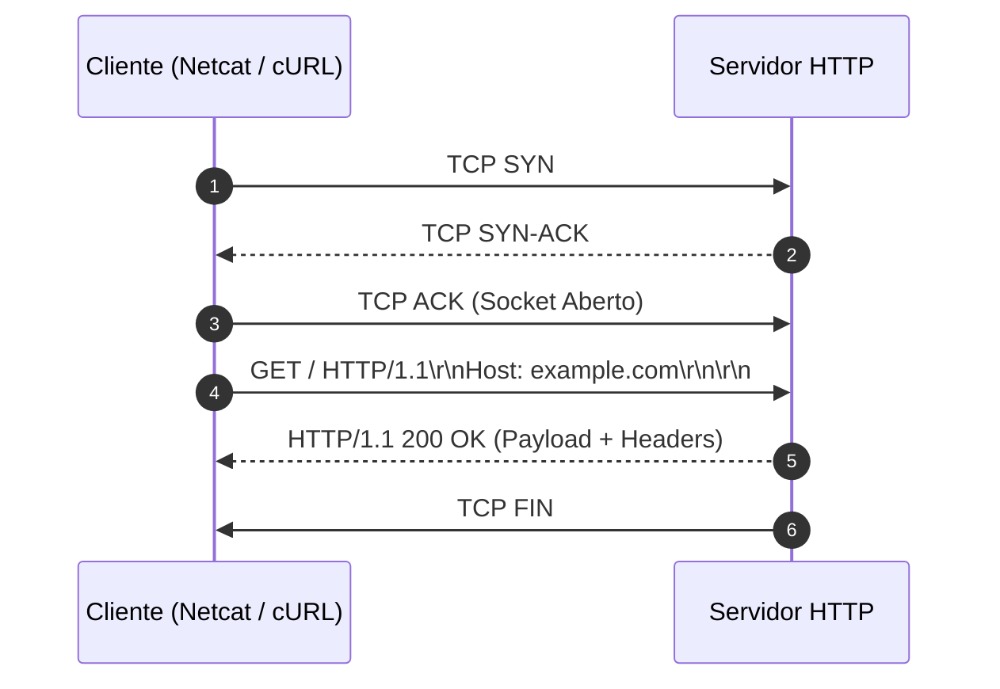

# Memória de Desenvolvimento — Semana 01: Protocolo HTTP & Sockets Bare-Metal
**Aluno:** Kayki Santana Guimarães
**Matrícula:** 202421200080 
**Curso:** Sistemas de Informação  

---

## 1. Mapeamento da Camada de Transporte
Diagrama Mermaid:

### Análise do Diagrama
1. **Passos 1 a 3, handshake de três vias:** o cliente envia `SYN`, o servidor responde `SYN-ACK` e o cliente confirma com `ACK`. Só depois disso o socket está aberto e os dois lados podem trocar dados.
2. **Passo 4, requisição HTTP:** o cliente envia a request `GET / HTTP/1.1` e o header `Host: example.com`, cada linha terminada em `\r\n`. A linha em branco final, `\r\n\r\n`, avisa ao servidor que os headers acabaram.
3. **Passo 5, resposta HTTP:** o servidor responde com status `HTTP/1.1 200 OK`, os headers e o corpo.
4. **Passo 6, encerramento:** o servidor envia `FIN` depois do último byte do corpo e a conexão é fechada.

---

## 2. Registro dos Experimentos de Laboratório

### Experimento 1: Netcat Nu & Falha 400 Bad Request
* **Comando Testado:** `nc -C example.com 80` sem o header `Host:`
* **Resultado:** O servidor retornou `HTTP/1.1 400 Bad Request`. No HTTP/1.1 o header `Host` é obrigatório porque um mesmo IP e uma mesma porta 80 podem hospedar vários sites, o chamado Virtual Hosting. O IP já foi resolvido na conexão TCP, então só o `Host` diz ao servidor qual site o cliente quer. Sem ele o servidor não sabe qual site entregar.

### Experimento 2: Semântica dos Métodos HTTP
* **Análise dos Verbos:** O `GET` pede um recurso disponível no servidor. O `POST` envia dados no corpo para o servidor processar, como criar um registro. O `OPTIONS` pergunta ao servidor quais métodos ele aceita para aquele recurso.
* **Header Content-Length:** O servidor lê os headers até a linha em branco e depois lê exatamente o número de bytes indicado em `Content-Length`. Se o cliente enviar menos bytes do que declarou, o servidor fica esperando o restante no buffer até estourar o timeout. Se enviar mais, os bytes extras são tratados como o início de uma nova requisição.

### Experimento 3: URL, Query Strings & Percent-Encoding
* **URL Testada:** `https://httpbin.org/get?curso=Engenharia%20da%20Computa%C3%A7%C3%A3o`
* **Mapeamento Hex:** O `%20` é o byte `0x20`, que em decimal é 32 e representa o espaço. O `ç` não existe no ASCII, então em UTF-8 ele ocupa dois bytes, `0xC3` e `0xA7`, e cada byte vira um `%` seguido do seu valor em hexadecimal, resultando em `%C3%A7`. O httpbin decodifica tudo e mostra `Engenharia da Computação`. 

### Experimento 4: Negociação de Conteúdo & User-Agent
* **Análise:** O header `Accept` informa o formato que o cliente aceita, como `text/html` ou `application/json`, e o servidor escolhe a representação adequada ou responde `406 Not Acceptable` se não tiver nenhuma. O `User-Agent` identifica o cliente: no laboratório o httpbin devolveu `curl/` seguido da versão, e um navegador apareceria com uma string completamente diferente. 

### Experimento 5: Redirecionamentos & Cache Condicional
* **Redirecionamento (301):** Sem a flag `-L`, o `curl -I` mostra só a resposta `301 Moved Permanently` com o header `Location`, que aponta para o novo endereço, e para ali. Com `-L`, o curl segue o `Location` automaticamente e mostra a resposta final.
* **Validação de Cache (304):** Na primeira resposta o servidor envia um header `ETag`, que identifica a versão atual do recurso. O cliente guarda o recurso e, na próxima requisição, envia o `ETag` no header `If-None-Match`. Se o recurso não mudou, o servidor só responde `304 Not Modified`. 

---

## 3. Conclusão Técnica
O HTTP é uma força de mensagens em texto ASCII enviada como bytes sobre TCP, em que cada linha termina em CRLF e uma linha em branco separa os headers do corpo. Como o TCP não marca onde cada mensagem começa e termina, é a própria sintaxe do HTTP que faz essa delimitação, por meio do CRLF, do `Content-Length` e do `Transfer-Encoding: chunked`. 

Entender como o HTTP funciona dessa forma é importante porque a velocidade e a confiabilidade de um sistema dependem desses detalhes. Reutilizar a mesma conexão para várias requisições, aproveitar o cache para não baixar a mesma coisa duas vezes e seguir redirecionamentos corretamente fazem o sistema responder mais rápido e gastar menos rede. 
